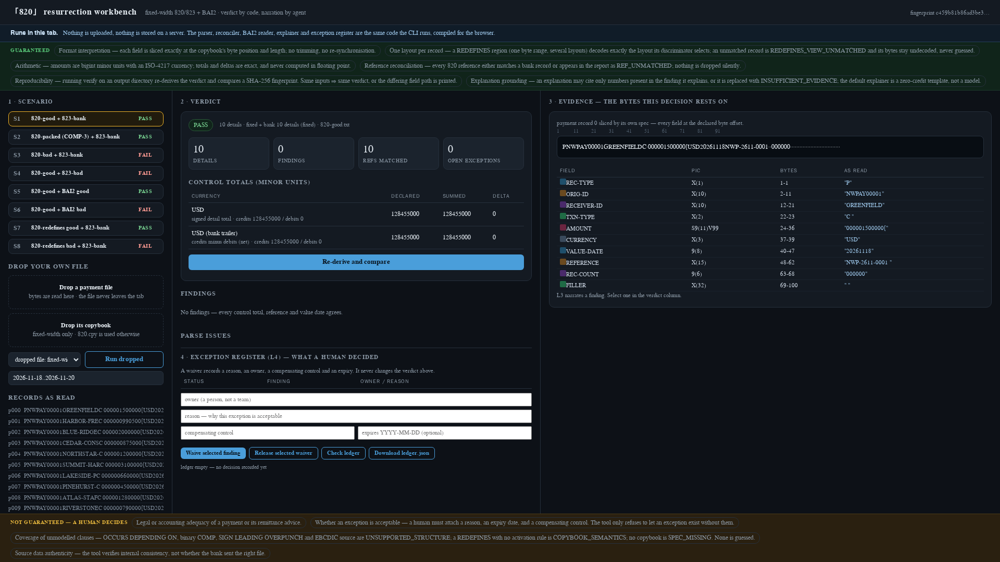
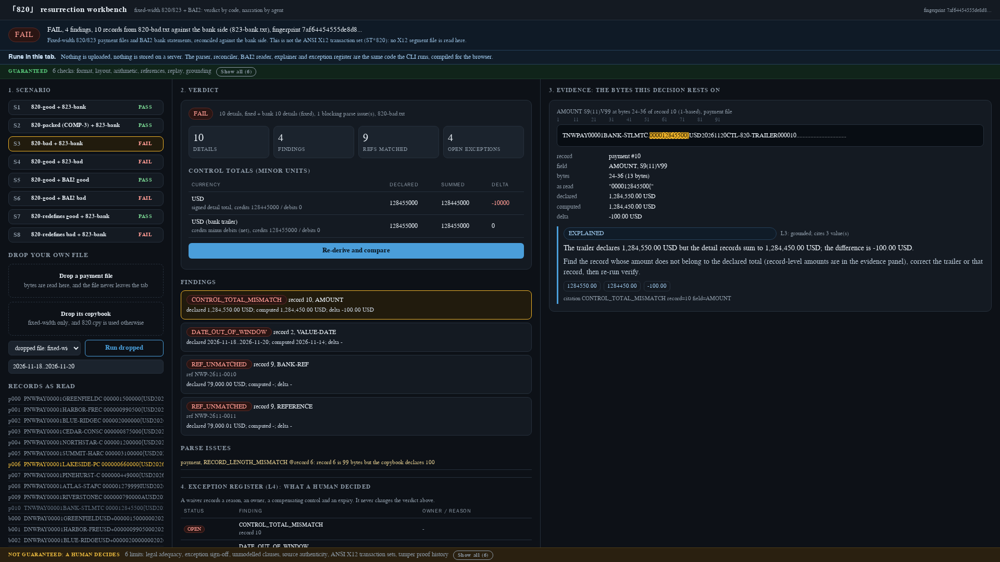
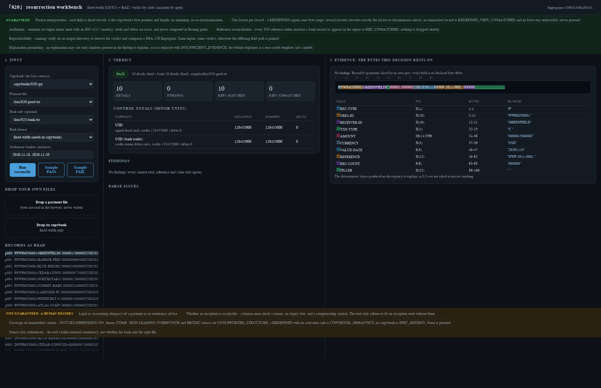
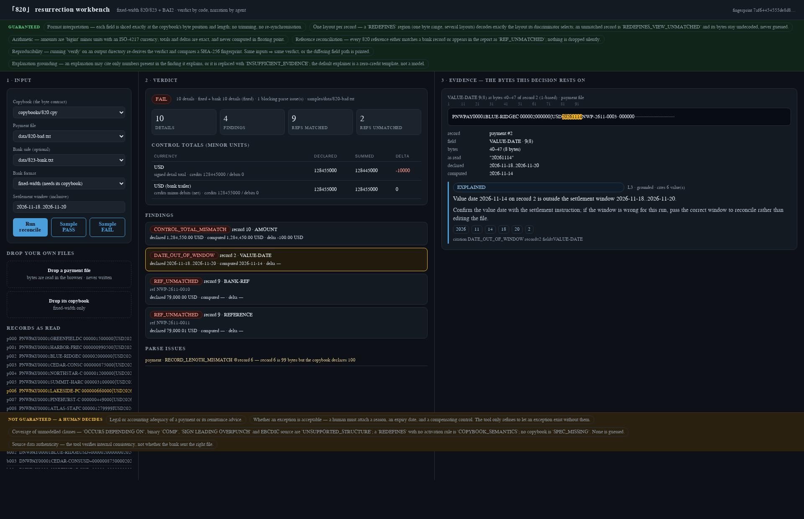
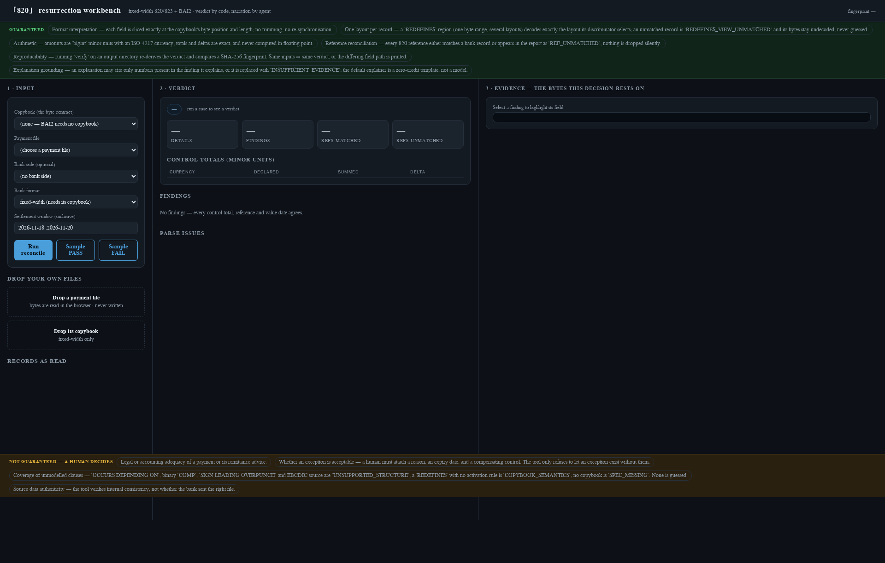
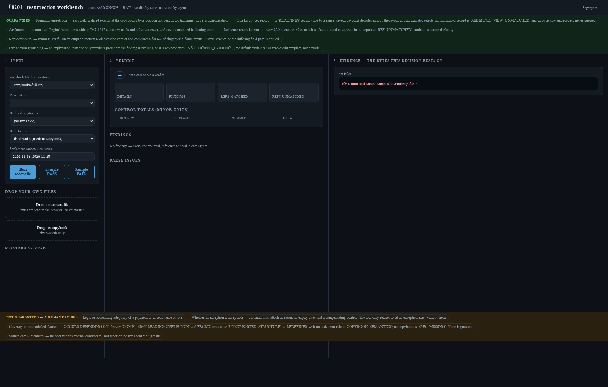

# 「820」: resurrection workbench for dead payment files

Corporate payment files never died. The people and tools that could read them did.

A bank back office still receives fixed-width payment files from a COBOL era and no longer has anyone who can read them. 「820」 reads a file against its copybook, or a BAI2 statement against its own layout, reconciles it with the bank's answer, and returns a verdict that a stranger can re-run with one command. A model never decides whether the numbers match, and by default it is not called at all.

- **Watch it, 2 minutes 41 seconds:** https://youtu.be/65xfo3u-DaU
- **Click it, no install and no server:** https://luke-shin-ai.github.io/edi820-workbench/demo/
- **Check it:** 334 tests in 25 files, 31 of them properties; `npm run check:claims` compares every count this file states with the code
- **Built with Kiro, Kiroween 2026, Resurrection category:** a spec of 33 requirements in EARS form, five steering files, three hooks, a reviewer agent over MCP, and the committed Kiro sessions that show each of them running
- **Check the verdict itself:** `820 verify` re-derives the answer from the inputs and prints `identical`, or names the first field that moved

### Where Kiro is used, in five paths

| Surface | Path | What is in it |
|---|---|---|
| Spec | [`.kiro/specs/edi820-importer/`](.kiro/specs/edi820-importer/requirements.md): [requirements](.kiro/specs/edi820-importer/requirements.md), [design](.kiro/specs/edi820-importer/design.md), [tasks](.kiro/specs/edi820-importer/tasks.md) | 33 requirements in EARS form, the design they imply, and the task list. Task T7.1 built the exception register |
| Steering | [`.kiro/steering/`](.kiro/steering/) | five files: product, tech, structure, conventions, finance-file-conventions. The no-floating-point rule for money is why every amount is a `bigint` |
| Hooks | [`.kiro/hooks/parser-guardrails.json`](.kiro/hooks/parser-guardrails.json) | PostFileSave runs the tests, Stop re-derives the newest verdict, PostTaskExec writes its own evidence row. Firings are in `out/hook-log.txt` |
| Agents | [`.kiro/agents/820-implementer.json`](.kiro/agents/820-implementer.json), [`.kiro/agents/reviewer.json`](.kiro/agents/reviewer.json) | the implementer wrote spec task T7.1; the reviewer answers with the project's own MCP server instead of an opinion |
| MCP | [`.kiro/settings/mcp.json`](.kiro/settings/mcp.json) | five tools, `allowedTools` scoped to `@820` |

The sessions that show these running are in [`docs/kiro-session-transcripts.md`](docs/kiro-session-transcripts.md); what each one produced is in [`docs/kiro-session-evidence.md`](docs/kiro-session-evidence.md). Used surface: Kiro CLI 3.5.0 (V3 engine) with `--agent`. Not used, and not claimed: Kiro IDE, Kiro Web, Kiro Crew and Kiro powers. The free plan has no Web or Crew, and a shallow last-minute use would not be an experiment worth reporting.

> **Build status (2026-11-27):** every layer is implemented and verified locally. L1 (copybook compiler with **`REDEFINES` layouts** + fixed-width parser + **BAI2 reader**), L2 (reconciler), **L3 (zero-credit grounded explainer)**, **L4 (exception register, implemented by Kiro from spec task T7.1)**, four surfaces (**CLI, local screen, static browser build, MCP server**) and the English demo video. Re-run on 2026-11-27: `npm run typecheck` clean, `npm run check:claims` 16/16, `npm run verify:public` 2/2 published files with 0 issues, `npm run build:static` regenerates `docs/demo`, and `python3 scripts/check-static.py` passes every check in a real browser at 1920. `npm test` reports **334 tests / 25 files** (unit, property-based and regression, 31 of them properties); the demo video, recorded on 2026-11-22, states the count in force then (311), and the 23 cases added afterwards cover the MCP path allowlist, the ledger head, and the two published BAI2 files. The repository is public at https://github.com/luke-shin-ai/edi820-workbench, the static build is live on GitHub Pages, and the Devpost entry is submitted at https://devpost.com/software/820-a-reconciliation-workbench-for-dead-payment-files.

Corporate payment files never died. The people and tools that could read them did.

Two families of file are meant here. **Fixed-width payment and remittance files** whose 820/823 style layouts are described by a **COBOL copybook**: the payer's payment order (820) and the bank side answer (823), which in this repository is a remittance and lockbox confirmation, not a bare notice that a payment arrived. And **BAI2** bank statements, which carry their own layout. Both are positional, so what a byte means comes from its offset. Neither is the delimited **ANSI X12** transaction set that uses the same 820/823 numbers (`ST*820*...~`): a standard X12 segment parser is not part of this build and is a roadmap item. Back-office teams retype these files into spreadsheets and hope.

「820」 takes a file **and its copybook** (or a BAI2 file, which needs none) and does four things, in four separate layers:

| Layer | What it does | AI? | Where |
|---|---|---|---|
| L1 parser | types every record exactly per the copybook or the BAI2 layout (position, length, sign, implied decimals), including `REDEFINES` regions where one byte range has two layouts | no | `src/copybook`, `src/parser`, `src/bai2` |
| L2 reconciler | control totals, counts, references, date windows -> coded findings with signed `bigint` deltas | no | `src/reconcile` |
| L3 explainer | explains each finding in plain language, citing only numbers L1/L2 produced; anything else becomes `INSUFFICIENT_EVIDENCE`. Default is the `grounded` template: deterministic, zero credits | agent, optional | `src/explain` |
| L4 register | records a human decision per finding: owner, reason, compensating control, expiry, hash chained and append only | human | `src/exception` |

The verdict is **deterministic and re-verifiable** (`820 verify`); the model never decides whether numbers match, and by default it is not called at all. A waiver never turns a verdict green: the register says what a person accepted, beside the answer the code produced.

The register is **tamper-evident, not tamper-proof**. Its chain is keyless: each link is a plain SHA-256 of the previous hash and the entry, with a recorded head, so an entry that was edited, reordered or cut from the tail is detected and `verify` fails naming the sequence. It does not stop the edit. Anyone who can write the ledger file can recompute every hash and the head and produce a file that still verifies, because there is no key the writer lacks and no witness outside the file. An outside anchor for the head is a roadmap item, not a claim.

Verdicts: `PASS` (every check agreed), `INCOMPLETE` (a parse issue left bytes uninterpreted, so no PASS is earned), `FAIL` (findings exist). Exit codes are `0` / `2` / `3`.

## Watch it

**https://youtu.be/65xfo3u-DaU** (public, 2 minutes 41 seconds). The same file is `demo-video/820-demo-en.mp4`, 2 minutes 41 seconds, 1920x1080, English narration and burned-in subtitles, no music. It opens on the running page, not a terminal: the money sentence, the `COBOL GHOST` guide bar, bytes 24 to 36 of the first finding, and the register after a waiver with the verdict still FAIL. Then the spec and the steering files as documents read from `.kiro`, the hook log from a real Kiro session, the bank copybook with its two `REDEFINES` layouts, the BAI2 delta, `verify`, the test suite (334 in 25 files), and the end card. The 2026-11-22 cut is unlisted; it opened with the hook log and predates the guide bar. Script and shot list: `demo-video/build/README.md`.
## Try it with no server

**https://luke-shin-ai.github.io/edi820-workbench/demo/** runs the same build from GitHub Pages.

`docs/demo/index.html` is a static build of the same engine: the parser, the reconciler, the BAI2 reader, the L3 grounded explainer and the L4 register compiled for the browser by `esbuild`. The first line of the page is the answer for the open scenario (`FAIL, 4 findings, 10 records from 820-bad.txt against the bank side (823-bank.txt), fingerprint 7af64454...`), above the scenario rail and the record dump, and it says in the same block that this is not the ANSI X12 transaction set (`ST*820`). Eight scenarios run with one click (the two `REDEFINES` ones included), a dropped file is read as bytes (`arrayBuffer`, so a COMP-3 amount survives), the register accepts a waiver and a release, and `Re-derive and compare` re-runs the case and prints the fingerprint. Nothing is uploaded: after the two files load, no request leaves the tab. A guide bar under the first line, added on 2026-11-27 in answer to the Kiroween judge briefing, speaks as the program that kept these totals and carries the next tap: on a failing case it opens the finding whose bytes caused the difference, and once a person waives that finding it reports the decision without changing the verdict. The rest of the screen is the one in the video.

**What runs from that URL, and what does not.** The Pages build runs L1, L2, L3 (grounded template), L4 and `verify` in the tab, for the eight bundled scenarios and for a file you drop. The CLI, the local screen on `127.0.0.1` and the MCP server are not reachable from a URL, because they read files from a working directory and the screen exists to keep payment files on the machine that received them. `scripts/check-static.py` is the check that the browser build is the same engine: it runs Chromium at 1920, executes all eight scenarios, and compares each verdict, finding count and fingerprint with the CLI's for the same inputs (all equal), then exercises a dropped COMP-3 file, a waiver, a release, `Re-derive and compare`, and asserts that no request leaves the tab and no console error appears. It takes the repository root from its own location, so a fresh clone runs it as is, with no path to set. Its last full run was 2026-11-27, from a clone outside the author's working directory: every check passed.




```bash
npm run build:static                  # regenerate docs/demo from src/static
python3 scripts/check-static.py       # Chromium at 1920: every scenario's fingerprint must equal the CLI's (needs `python3 -m pip install playwright && playwright install chromium`)
```

## Run it

```bash
npm install
npm test                       # 334 tests: npx vitest run
npm run typecheck              # tsc --noEmit for node + for the browser build, 0 errors
npm run demo:cli               # parse + reconcile eight scenarios (820/823/fixed/COMP-3/REDEFINES/BAI2)
npm run evidence               # write out/evidence/report.json, the report the hook re-derives
npm run check:claims           # every test/property/requirement count a document states, against the code
```

### Three minutes, one judge

```bash
npm install
npx tsx src/cli/main.ts reconcile --copybook samples/copybooks/820.cpy \
  --file samples/data/820-bad.txt --bank samples/data/823-bank.txt \
  --bank-copybook samples/copybooks/823.cpy --window 2026-11-18..2026-11-20 --out out/judge
# verdict: FAIL   findings: 4   fingerprint: 7af64454...   exit code 2
npx tsx src/cli/main.ts verify out/judge
# RESULT: identical: same inputs, same verdict   (report bytes and mtime unchanged)
npx tsx src/cli/main.ts exceptions out/judge --today 2026-11-21
# OPEN: 4  WAIVED: 0  EXPIRED: 0  RELEASED: 0   unadjudicated: 4   exit code 2
npm run web -- --port 8720     # then open http://127.0.0.1:8720/ and press "Sample FAIL"
```

No network, no credentials, no hosted service for the back-office path: the screen binds to `127.0.0.1` because payment files should not leave the machine they arrived on. The static build exists for the judge who cannot run anything.

### CLI

```bash
# fixed-width: the file plus its copybook
npm run cli -- parse     --copybook samples/copybooks/820.cpy --file samples/data/820-good.txt --out out/demo
npm run cli -- reconcile --copybook samples/copybooks/820.cpy --file samples/data/820-bad.txt \
                                  --bank samples/data/823-bank.txt --bank-copybook samples/copybooks/823.cpy \
                                  --window 2026-11-18..2026-11-20 --out out/demo
# BAI2: no copybook, just --format bai2
npm run cli -- reconcile --copybook samples/copybooks/820.cpy --file samples/data/820-good.txt \
                                  --bank samples/data/bai2-bad.txt --bank-format bai2 --out out/demo
npm run cli -- explain   --findings out/demo            # L3, grounded template, 0 credits
npm run cli -- verify    out/demo                       # re-derive + compare, read-only

# L4: the human decision, recorded
npm run cli -- exceptions out/demo --today 2026-11-21
npm run cli -- waive   --report out/demo --index 0 --owner "S. Shin (TPM)" \
                       --reason "Annex A total approved against the corrected statement." \
                       --control "Daily suspense-account check" --expires 2026-12-05 --today 2026-11-21
npm run cli -- release --report out/demo --id <waiver id> --owner "S. Shin (TPM)" \
                       --reason "Corrected trailer received." --control "Trailer re-issued" --today 2026-11-22
```

Exit codes: `0` all checks pass (and no open exception where the command reports exceptions); `2` findings present, `INCOMPLETE`, a verification difference, or an open/expired/released exception; `3` spec, I/O or ledger-integrity error. `explain` exits `2` when a finding cannot be grounded. `--json` prints the same document the report file holds.

### Web screen (three columns)

```bash
npm run web -- --port 8720     # then open http://127.0.0.1:8720/
```

[Left] copybook/file pickers, drop zones for your own files, records as read; [middle] verdict card, counters, control totals (with the comparison basis and the credit/debit split), findings, parse issues; [right] the record with the finding's field highlighted **at its byte offsets**, or the copybook's field-by-field layout when there is nothing to highlight, plus the L3 explanation and the values it cited. The guaranteed / not-guaranteed strips are fixed at the top and bottom of the screen.




Empty state and error state are real captures of the same screen, not mockups:




Binds to `127.0.0.1` only. Dropped files travel as base64 of their bytes, are parsed from the request body, and are never written anywhere.

### MCP server (5 tools)

```bash
npm run mcp                  # newline-delimited JSON-RPC 2.0 on stdio
node scripts/mcp-call.mjs    # a real client: initialize, tools/list, reconcile, verify, exceptions
```

| tool | returns |
|---|---|
| `parse_file` | typed-record counts, coded parse issues, hashes, fingerprint (no verdict) |
| `reconcile` | PASS / INCOMPLETE / FAIL, findings with declared/computed/delta, summary, fingerprint |
| `explain_findings` | one grounded explanation per finding (`INSUFFICIENT_EVIDENCE` when it cannot be grounded) |
| `verify` | both fingerprints, first differing field path, proof the report was not modified |
| `exceptions` | per-finding status (OPEN/WAIVED/EXPIRED/RELEASED), counts, and the ledger digest: entry count, head hash, and whether the chain and the head agree |

Each returns the same JSON the CLI writes, because all three surfaces call `src/core/ops.ts`. The reviewer agent in `.kiro/agents/reviewer.json` calls these tools, and `.kiro/settings/mcp.json` registers the server for the workspace.

**What an agent may reach.** An MCP client is a model, so a path in a tool argument is untrusted. `filePath`, `copybookPath` and `bankFilePath` are accepted only under `samples/`, `out/` or the server's working directory, and `outDir` only under `out/`; anything else is refused before a file is opened, including a `..` climb or a symlink that leaves those roots (`src/mcp/server.ts`, `resolveAllowedPath`). `explain_findings` caps `maxLiveCalls` at 3 and defaults to 0, so an agent cannot spend credits or reach a network adapter without a person asking for it. `.kiro/settings/mcp.json` auto-approves only the two read-only tools, `parse_file` and `verify`; `reconcile` (which can write a report) and `explain_findings` ask first.

## `REDEFINES` is read, not guessed

A bank copybook does not give the control trailer its own bytes. It gives the record one 100-byte area and declares the trailer as a second description of that area, `PAYMENT-TRAILER REDEFINES PAYMENT-DETAIL`. The compiler reads that as a region with two layouts. COBOL does not say which record type uses which layout, so the copybook must: one `* @view layout=... typeField=REC-TYPE value=P|T` per layout, and a `REDEFINES` with no such rule is refused (`COPYBOOK_SEMANTICS`) instead of read as whichever layout fits. At parse time exactly the selected layout is decoded; the other layout's field names are absent from the record, and a record whose type byte matches no layout is `REDEFINES_VIEW_UNMATCHED`, which cannot earn a PASS. `samples/copybooks/820-redefines.cpy` is the sample, `docs/copybook-dialect.md` §4 the rule book, and `test/regressions/redefines-view.test.ts` pins both the behaviour and the six pre-existing scenario fingerprints.

## BAI2 is read, not disguised

BAI2 has no fixed width and no copybook. Rather than fake a layout for a comma-delimited format, `src/bai2` is a dedicated reader for records `01/02/03/16/49/88/98/99` that produces the same `ParseResult` the reconciler already understands: amounts as `bigint` minor units with the currency's exponent, direction from the type code (`100-399` credit, `400-699` debit), per-record field offsets for the evidence panel, and its own checks of the account, group and file trailers. A `03` code `100` declares *total credits*, while the detail records it is compared against net credits against debits, so the reader keeps gross credit and debit totals per currency and every delta names both parts. See [`docs/bai2.md`](docs/bai2.md).

## Verified against BAI2 files banks publish

The fixtures are ours, so they cannot prove the reader handles a file it did not help write. Two BAI2 files published by banks are committed verbatim in `samples/public/` and parsed by `src/bai2` on every test run:

| file | published by | records | declared total credits | result |
|---|---|---|---|---|
| `bai2-westpac-npp.txt` | Westpac / Qvalent, BAI2 NPP sample file (CRLF, as published) | 27 (10 detail) | 4,000,000 AUD | 0 issues |
| `bai2-southstate-guide.txt` | SouthState Bank, BAI-2 user guide, sample file p.12 (four accounts in one group) | 27 (12 detail) | 20,042,948 USD | 0 issues |

```bash
npm run verify:public        # parse both files, print the result, exit 1 on any issue
```

Both files agree with the reader on the `49` account control totals, the `98` group totals and the `99` file totals. Getting there fixed a real defect rather than the samples: the reader used to read only the first `[type code, amount]` pair of an `03` record and to compare the `49` total against *signed* details, which no published file satisfies. It now reads every summary group of an `03` and the `88` continuations that carry the rest of one, and adds the amounts as they appear on the wire. `samples/public/SOURCES.md` records the URLs, the download date, what was normalised, and what could and could not be established about permission to reproduce them (both are published format samples with no stated licence, so the basis is attribution plus removal on request).

**EBCDIC is out of scope for this build.** Mainframe estates mostly store these files in EBCDIC, and this reader takes ASCII and latin1 bytes: an EBCDIC file is not decoded, its records fail the layout and amount checks (`RECORD_LENGTH_MISMATCH`, `FIELD_INVALID_NUMERIC`, `BAI2_STRUCTURE`) and the run cannot earn a PASS. Reading EBCDIC is a roadmap item, written up as such in `docs/guarantees.md`; the claim here is about the format and the layout, not about the character set a particular host uses.

## How Kiro built it (evidence, not adjectives)

- `.kiro/specs/edi820-importer/`: `requirements.md` (EARS, R1 to R8) -> `design.md` -> `tasks.md`; `design.md` §12 and §13 record every implementation delta, including the two stack substitutions (MCP protocol implemented directly instead of `@modelcontextprotocol/sdk`; the screen as one dependency-free document instead of Vite + React) and why
- **Which Kiro surfaces were used, stated plainly.** The CLI (`kiro-cli 3.5.0`) is the surface that ran: `whoami`, `agent list`, `agent validate`, the custom `820-implementer` and `reviewer` agents, the hooks and the `@820` MCP server, in the sessions transcribed in [`docs/kiro-session-transcripts.md`](docs/kiro-session-transcripts.md). The Kiro IDE was not used for the spec flow: the spec in `.kiro/specs/` was written in this workspace from the copybooks and the code was written against it, so the difference a judge should expect to see is the CLI driving the work rather than a click-through in the IDE panel. Kiro Web is a Pro surface and this account is on the free plan, so it was not available; Kiro Crew was not used. That is a narrower tool set than the IDE-first workflow the write-up template describes, and it is why the evidence is a transcript rather than a screen recording of a spec panel.
- `.kiro/steering/`: product, tech (parsing rules), structure, conventions, and finance-file domain rules
- `.kiro/hooks/`: tests on save, re-verify on `Stop`, evidence appended on task completion. All three have fired in a live session: `out/hook-log.txt` is committed and holds every firing, and `docs/kiro-session-evidence.md` explains the three that were broken before (a command with no entry point, the wrong stop trigger, and the wrong task trigger)
- `.kiro/agents/reviewer.json` and `.kiro/agents/820-implementer.json`: the adversarial reviewer and the spec executor, both with `@820` MCP access
- `EVIDENCE.md`: the build log, with the defects the build found in itself (overpunch table off by one, implied decimals dropped when encoding, a blank reference silently dropped, BAI2 record counting, a truncated record that reached PASS, a verify that depended on the working directory)
- `docs/kiro-session-evidence.md`: the T7 session that implemented the exception register (what the agent wrote, what fired, what the reviewer got back from the MCP server, the repairs afterwards) and §8, the task-runner run that made `PostTaskExec` fire and wrote its own `EVIDENCE.md` row
- `docs/copybook-to-spec.md`: how the three synthetic copybooks became a Kiro spec (what it got right, what it got wrong). The copybooks are this project's own synthetic definitions, written on 2026-11-21; the page says where each decision came from and which steps were typed by hand
- `docs/kiro-session-transcripts.md`: the sanitized CLI session transcripts (S1 implementation of T7.1, S2 the reviewer through the MCP server, S3 a save that fired the hook), with the failed tool calls left in
- `docs/kiro-cli-validation.md`: the earlier CLI session, the agent validation, and the reviewer run that was confidently wrong
- `review.md`: self scoring on the five criteria, with what a cold judge would still mark down
- `devpost-submission-draft.md`: the submission text and the write-up, including how spec, steering, the custom agent, hooks, MCP and the CLI combine, and the five boundaries the submission keeps

## What this guarantees / does not guarantee
See [`docs/guarantees.md`](docs/guarantees.md), which is parsed and printed by `820 verify` and shown in both strips of the screen. Short version: it guarantees format interpretation (including one active layout per `REDEFINES` region), exact arithmetic, reference reconciliation, reproducibility and explanation grounding; it does **not** guarantee legal or accounting adequacy, whether an exception is acceptable (a human's call, on purpose), the authenticity of the source data, delimited ANSI X12 transaction sets (not read here), or the immutability of the register (its chain is tamper-evident only).

## Data

The fixtures this project generates are **synthetic** (fictional company *Northwind Pay*), and every planted defect is asserted by `test/unit/fixtures.test.ts`. `samples/public/` holds two BAI2 files published by banks as format examples, copied verbatim with their sources in `samples/public/SOURCES.md`; their account numbers and names are the publishers' fictitious examples. No customer, bank or employer data is used anywhere in this repository.

## License

Apache-2.0: see `LICENSE`.
